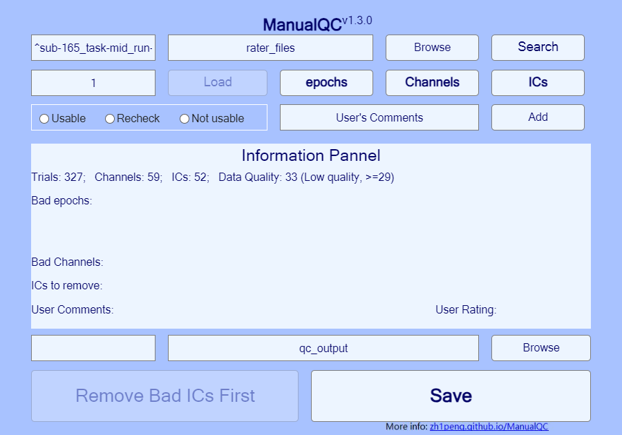

# ManualQC

#### Current Version: v1.3.0

ManualQC is a MATLAB toolbox for reviewing epoched EEG in EEGLAB. A reviewer can mark epochs for rejection, select channels for spherical interpolation, inspect ICA components, and save the cleaned recording with a record of those decisions. The companion **RaterTool** compares independent reviewers and replays disagreements against the original signal.

**[Illustrated handbook](https://zh1peng.github.io/ManualQC/)** · **[中文教程](https://zh1peng.github.io/ManualQC/zh/)** · [Download current toolbox](https://github.com/zh1peng/ManualQC/archive/refs/heads/master.zip) · [Release notes](CHANGELOG.md)

## First session

Start [EEGLAB](https://eeglab.org/) in MATLAB. With the extracted repository as your current folder, run:

```matlab
addpath(fullfile(pwd,'manualqc'))
mkdir('qc_output')
manualqc
```

1. Set the search directory to `rater_files`, enter `^sub-165_task-mid_run-01_eeg_prep\.set$`, click **Search**, then **Load**. The sample has 327 epochs, 59 channels and 52 ICs.
2. Inspect **epochs**, **Channels** and **ICs**. In the epoch viewer, **Mark** confirms the current selection; **Clear → Mark** confirms an empty selection; **Cancel** retains the selection from before opening.
3. Add a comment, choose a rating and set the output directory to `qc_output`. **Save** writes the processed dataset and QC log. Reopen the output to inspect `EEG.etc.manualqc`.



The workbench displays **Data Quality: 33 (Low quality, >=29)**. Lower scores generally indicate better quality for recordings with comparable preprocessing. See [how the score is calculated](https://zh1peng.github.io/ManualQC/guide/start.html#data-quality) and [how to search by filename](https://zh1peng.github.io/ManualQC/guide/start.html#filename-patterns).

## Compare reviewers

Run `ratertool` and select the three example rater files in [rater_files](rater_files/). Use that folder as the data root, compute agreement, and replay a shared recording. Use the **same pre-manual-QC dataset** for all raters. The [RaterTool walkthrough](https://zh1peng.github.io/ManualQC/guide/raters.html) and [agreement reference](https://zh1peng.github.io/ManualQC/guide/agreement.html) explain what a score measures and when it is undefined.

## Reporting use

Report the toolbox version, the input preprocessing and your lab's rejection criteria. For example: “Epoched EEG was reviewed with ManualQC v1.3.0 (Zhipeng Cao; https://github.com/zh1peng/ManualQC).” Describe which of epoch rejection, channel interpolation and IC removal you actually performed. [License](LICENSE).

## Develop locally

The MATLAB toolbox is in `manualqc/`. Run the [ManualQC regression checks](tests/run_manualqc_regression.m) and [RaterTool tests](tests/test_ratertool.m) in MATLAB with EEGLAB available. The website is separate; Node.js is not required to use the toolbox.

```sh
cd website
npm ci
npm run dev
# npm run build produces the static handbook in .vitepress/dist/
```


